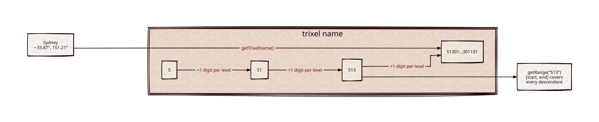

# htm

Part of [Kronuz C++ Libraries](https://github.com/Kronuz/cpp-libraries), a collection of small, reusable C++ libraries.

[](https://github.com/Kronuz/htm/actions/workflows/ci.yml)
[](LICENSE)


The Hierarchical Triangular Mesh for C++20: tile the sphere with nested
triangles ("trixels") so every point gets a name and a 64-bit id, where a name
prefix is an area and an id range is everything inside it. For geospatial
indexes on the whole globe, with no projection seams.



## ✨ Highlights

- **Names and ids.** `getTrixelName(point)` and `getId(point)`, and conversion
  between the two.
- **Ranges for indexes.** `getRange(name)` is the id interval of a trixel's whole
  subtree, so an area query becomes integer range scans.
- **Set algebra** on trixel sets and id ranges: union, intersection, exclusive
  disjunction.
- **Spherical caps.** `Constraint` describes a circle on the sphere, the primitive
  for ranging circular regions.
- **Whole-sphere coverage**, no poles or date-line special cases.

## 📦 Installation

Requires a C++20 compiler and CMake 3.14 or newer; it fetches
[cartesian](https://github.com/Kronuz/cartesian) and compiles two source files.
CI builds it on Linux (x86_64, arm64), macOS (arm64, x86_64), and FreeBSD, plus
ASan, UBSan, and TSan builds.

```cmake
include(FetchContent)
FetchContent_Declare(htm
  GIT_REPOSITORY https://github.com/Kronuz/htm.git
  GIT_TAG        main)
FetchContent_MakeAvailable(htm)

target_link_libraries(my_app PRIVATE htm::htm)
```

## 🚀 Quick start

```cpp
#include "htm.h"

#include <cstdio>

int main() {
	Cartesian sydney(-33.8688, 151.2093, 0.0, Cartesian::Units::DEGREES);
	std::string name = HTM::getTrixelName(sydney);   // "S13011231030232202122301131"
	uint64_t id = HTM::getId(sydney);                // 15506219993771101

	range_t area = HTM::getRange(name.substr(0, 3)); // everything inside "S13"
	std::printf("%d\n", area.start <= id && id <= area.end);   // 1
}
```

[`examples/demo.cc`](examples/demo.cc) zooms out by trimming a name and prints a
trixel's corners.

## 🎯 When to use it

- ✅ Indexing points on the globe in a sorted key store: one integer per point,
  range scans per area.
- ❌ Distances or projections: use [cartesian](https://github.com/Kronuz/cartesian)
  for geometry; HTM only partitions the sphere.

## 📚 Documentation

- [docs/API.md](docs/API.md): naming, ranges, set algebra, and constraints, with
  examples.
- [ARCHITECTURE.md](ARCHITECTURE.md): the subdivision, the id encoding, and the
  range math.
- [AGENTS.md](AGENTS.md): repository map, invariants, and traps.

## 🛠️ Building and testing

```sh
cmake -B build && cmake --build build && ctest --test-dir build
./build/htm_demo
```

## 🤝 Contributing

Issues and pull requests are welcome. Ids are stored in indexes, so the encoding
must not change; read [AGENTS.md](AGENTS.md) first. CI must pass on every
platform.

## 📄 License

MIT, Copyright (c) 2015-2019 Dubalu LLC. See [LICENSE](LICENSE). Extracted from
[Xapiand](https://github.com/Kronuz/Xapiand), where it backs geospatial search.
