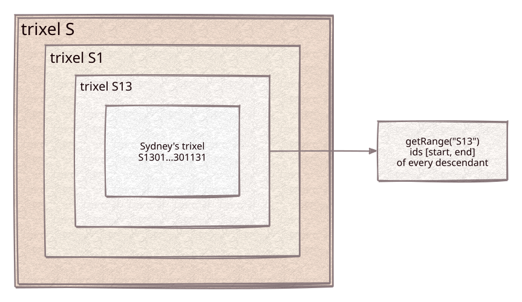

# htm

Part of [Kronuz C++ Libraries](https://github.com/Kronuz/cpp-libraries), a collection of small, reusable C++ libraries.

[](https://github.com/Kronuz/htm/actions/workflows/ci.yml)
[](LICENSE)


Hierarchical Triangular Mesh for C++20: a 64-bit id for every point on the sphere, and an id range for every area.
The mesh tiles the sphere with nested triangles (trixels), and a point's trixel name grows
one digit per level, so a name prefix is an area and its id range holds everything inside
it. Reach for it to index points on the whole globe in a sorted key store, with no
projection seams.



## ✨ Highlights

- **Names and ids.** `getTrixelName(point)` and `getId(point)` locate a point down to
  level 25, and `getTrixelName(id)` and `getId(name)` convert between the two forms.
- **Ranges for indexes.** `getRange(name)` is the id interval of a trixel's whole subtree,
  so an area query becomes integer range scans.
- **Set algebra.** Union, intersection and exclusive disjunction over sorted trixel names
  and over sorted id ranges.
- **Spherical caps.** `Constraint` is a circle on the sphere, with tests for a point
  inside it and for its overlap with a trixel.
- **Stable ids.** `getId` returns the same id whether or not the compiler fuses
  multiply-adds; CTest checks it against an IEEE-754 reference and a table of golden ids.
- **Whole-sphere coverage.** Poles and the date line need no special cases.

## 🚀 Quick start

```cpp
#include "htm.h"

#include <cstdio>

int main() {
	Cartesian sydney(-33.8688, 151.2093, 0.0, Cartesian::Units::DEGREES);
	std::string name = HTM::getTrixelName(sydney);   // "S13011231030232202122301131"
	uint64_t id = HTM::getId(sydney);                // 15506219993771101

	range_t area = HTM::getRange(name.substr(0, 3)); // everything inside "S13"
	std::printf("%d\n", area.start <= id && id <= area.end);   // 1
}
```

[`examples/demo.cc`](examples/demo.cc) zooms out by trimming a name and prints a trixel's
corners.

## 📦 Installation

Requires a C++20 compiler and CMake 3.14 or newer; it fetches
[cartesian](https://github.com/Kronuz/cartesian) at a pinned commit and compiles two source
files. CI builds it on Linux (x86_64, arm64), macOS (arm64, x86_64), and FreeBSD, plus
ASan, UBSan, and TSan builds.

```cmake
include(FetchContent)
FetchContent_Declare(htm
  GIT_REPOSITORY https://github.com/Kronuz/htm.git
  GIT_TAG        b4993b1fe793a3cb0fb525df23b9cc777ea76af6)  # or main, to track the tip
FetchContent_MakeAvailable(htm)

target_link_libraries(my_app PRIVATE htm::htm)
```

```cpp
#include "htm.h"
```

## 🎯 When to use it

Use it to index points on the globe in a sorted key store: one integer per point, and
range scans per area.

Not for:

- **Distances or projections.** HTM only partitions the sphere; use
  [cartesian](https://github.com/Kronuz/cartesian) for geometry.
- **Ready-made region covers.** The library tests a `Constraint` against a trixel; turning
  a circle into a list of trixels or ranges is the caller's walk.

## ⚡ Performance

ns to name one point. `getId(Cartesian)` returns the 64-bit id of the level-25 trixel
(`HTM_MAX_LEVEL`, an edge of about 0.3 m, an area of 0.057 m²) that contains a unit vector;
`getTrixelName(Cartesian)` returns its 27-character name. The input is 20,000 random unit
vectors, uniform on the sphere, converted to each library's input type before timing, so a
row times the library call alone. Each value is the best of ten rounds (two runs of five
interleaved rounds). The columns:

- `htm` is this library.
- `SDSS HTM` is the Johns Hopkins C++ library of Kunszt, Szalay and Thakar
  ([vendored by gkhtm](https://github.com/genghisken/gkhtm/tree/e319c997a98019302428ca5667b288ee9c869deb)),
  `SpatialIndex::idByPoint` and `nameByPoint` at level 25. It numbers the same eight root
  trixels and the same children, so the bench aborts unless its names equal htm's down to
  level 14 on every input. All 25 levels agree on 53% of the inputs: SDSS decides with a
  fixed tolerance of 1e-15 and picks a neighbouring trixel at the finest levels. Its ids
  differ from htm's in one bit.
- `H3` is [H3 4.5.0](https://github.com/uber/h3/tree/v4.5.0), `latLngToCell` at resolution 15,
  and `S2` is [Google S2](https://github.com/google/s2geometry/tree/677c8cebcff11ba11accc0b02005bc214e06e9fd),
  `S2CellId` at level 25. They are other meshes with ids of their own, so the table has
  no `getTrixelName` for them (`-`). The levels match cell areas: S2 level 25 is 0.076 m²,
  H3 resolution 15, its finest, is 0.90 m², sixteen times an htm trixel. The bench checks
  that each cell centre lies within 1 m of its point.
- The last column is the SDSS time divided by the htm time.

| ns per call | htm | SDSS HTM | H3 | S2 | htm vs SDSS HTM |
| --- | ---: | ---: | ---: | ---: | ---: |
| `getId`, Apple M4 Pro | 591 | 962 | 497 | 19.8 | 1.63x faster |
| `getId`, Intel Core i9-9980HK | 795 | 1517 | 755 | 36.2 | 1.91x faster |
| `getTrixelName`, Apple M4 Pro | 662 | 962 | - | - | 1.45x faster |
| `getTrixelName`, Intel Core i9-9980HK | 962 | 1542 | - | - | 1.60x faster |

H3 and S2 are faster than htm on `getId`: H3 by 1.2x on the M4 Pro and 1.05x on the i9, S2 by
30x and 22x. S2 projects the point onto a cube face and looks the cell up, and htm descends 25
levels. Machines: Apple M4 Pro, macOS 26; Intel Core i9-9980HK, macOS 15 (x86-64); Apple clang
17, `-O3 -DNDEBUG` for every library. The comparators are fetched at configure time by the
bench target alone and are off by default:

```sh
cmake -B build -DCMAKE_BUILD_TYPE=Release -DHTM_BENCH_COMPARE=ON -DHTM_BENCH_S2=ON
cmake --build build --target htm_bench
./build/htm_bench
```

`HTM_BENCH_S2` needs abseil installed (Homebrew `abseil`). [docs/perf/](docs/perf/README.md)
has the method, every row with its spread and the SDSS comparison.

## 📚 Documentation

- [docs/API.md](docs/API.md): naming, ranges, set algebra and constraints, with examples.
- [ARCHITECTURE.md](ARCHITECTURE.md): the subdivision, the id encoding and the range math.
- [CHANGELOG.md](CHANGELOG.md): dated changes, with the measurements behind each one.
- [AGENTS.md](AGENTS.md): repository map, invariants and traps.
- [Kronuz C++ Libraries](https://github.com/Kronuz/cpp-libraries): the catalog.

## 🛠️ Building and testing

```sh
cmake -B build
cmake --build build
ctest --test-dir build
```

CTest `htm_diff` checks `getId` and `getTrixelName` on random points, poles, signed zeros,
axis planes and trixel vertices and midpoints against an IEEE-754 reference
(`test/ieee.h`), golden ids (`test/golden.h`) and the `Cartesian`-object walk
(`test/frozen.h`). `htm_fma` and `htm_rounded` run the same test on builds of `htm.cc` with
`-ffp-contract=fast` (and `-mfma` on x86).

## 🤝 Contributing

Read [AGENTS.md](AGENTS.md) and the [catalog's rules](https://github.com/Kronuz/cpp-libraries/blob/main/AGENTS.md)
first; ids are stored in indexes, so the encoding does not change.

## 📄 License

MIT, Copyright (c) 2026 Germán Méndez Bravo and (c) 2015-2020 Dubalu LLC. See
[LICENSE](LICENSE). Extracted from [Xapiand](https://github.com/Kronuz/Xapiand), where it
backs geospatial search.
